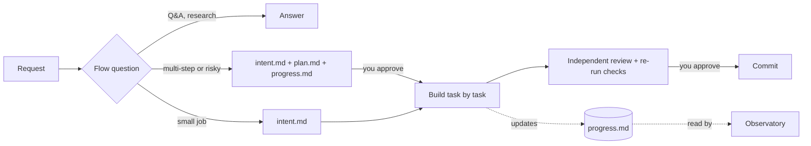

# Athena Starter

### Give Claude Code a memory that outlives the chat, and a process it can't skip.

Close the session, hit a context compaction, come back next week: the agent still knows **which project goal it is on, which plan it is running, and which task is next**. And every request it works on goes through the same disciplined path: route → scope → plan → red test → independent review → commit.

[](LICENSE)
[](#quick-start)
[](https://github.com/zzgiabaozzbui/athena-starter/releases/latest)
[](https://github.com/zzgiabaozzbui/athena-starter/actions/workflows/check.yml)

English · [Vietnamese](README.vi.md)

```
/plugin install athena-starter --marketplace zzgiabaozzbui/athena-starter
```


*Not a mockup: this is the real 14-task plan that built this kit, rendered by Agent Observatory. Each card is a task with its status, agents and token use; edges are dependencies.*

## Why

Coding agents are brilliant for twenty minutes and then forget everything. The plan lived in the chat, the chat got compacted, and now the agent is "starting fresh" on a job that was 60% done. Meanwhile it edited twelve files before anyone agreed on scope, "fixed" a bug without proving it, and reviewed its own work.

Athena Starter fixes both halves:

| | **🧠 Long-term memory** | **⚙️ A process that holds** |
|---|---|---|
| **What** | Project, plan and task state written to plain Markdown and JSON in your repo | 30 workflows, 18 skills, 6 agents and safety hooks |
| **Survives** | Context compaction, new sessions, a different machine, a teammate | Tired prompts, "just quickly fix this", the agent's own optimism |
| **You get** | "Where are we? What's left? What needs me?" answered from files, not guesses | Scope before edits, red test before fixes, a fresh-eyed reviewer before "done" |
| **You see it** | Agent Observatory: graph, Kanban board, timeline, roadmap | One flow question per request, recommended option first |

## 🧠 Memory: the agent always knows where it is

No database, no embeddings, no cloud. Memory is files you can read, diff and commit, organized in three levels:

| Ask in plain words | Level | Remembered in |
|---|---|---|
| "How far is the project? What is still missing?" | **Project** | `docs/du-an/lo-trinh.json`: goals, then items per goal with status, owner, deadline and acceptance criteria |
| "Where are we in the plan?" | **Plan** | `docs/artifact/<date-name>/plan.md`: tasks and the dependencies between them |
| "What is left? What is blocked? What needs me?" | **Task** | `progress.md`: one row per task, `TODO` · `DOING` · `CHỜ-USER` (waiting for you) · `BLOCKED` · `DONE` · `SKIP` |
| "What should happen next?" | **Task** | Ready tasks ranked by how many others wait behind them |

- **Picks up where it left off.** After a compaction the session hook tells the agent to resume the running plan from `intent.md` and `progress.md` instead of starting over. A new session reads the same files.
- **Written down before it starts.** Multi-step work gets `plan.md` and `progress.md`, approved by you, before task 1; the table is updated after every task.
- **Scope is memory too.** `intent.md` lists the files the agent may touch. Anything outside needs your OK by name, even three sessions later.

## ⚙️ Process: every request takes the right path

Before the agent reads or edits anything, it restates what you asked and routes it to one of **30 workflows**. A misread request costs one click, not ten edited files.

```
You:    Users can see other departments' records on the report screen.
Agent:  Flow: you want users to see only their own department's records. Which flow?
          > Auth / permissions · #12 (Recommended): CRITICAL, you approve the proposal before any edit, live test with an ordinary account
            Bug fix · #6: red test first
            UI change · #15: frontend only
```

Each flow carries its own risk level: a one-line permissions change gets the full process; a one-line typo fix does not.



1. **Route.** Restate the request, recommend a flow, list the runners-up.
2. **Scope.** Write `intent.md` with the files it may touch.
3. **Plan.** Multi-step or risky work gets `plan.md` + `progress.md` for your approval.
4. **Build.** Tasks go to the right agent (`developer`, `quick-fix`...). Fixes start with a test that fails for the right reason.
5. **Review and verify.** A reviewer with fresh context checks the diff; the main agent re-runs the checks itself instead of trusting the report.
6. **Commit.** Named files only, a sensitive-data scan first, and no push without your OK.

| Group | Flows |
|---|---|
| **Idea to delivery** | Vague request (clarify scope first) · Large one-sided feature · Feature across backend + frontend · Code review · Commit / push / release |
| **High-risk work** | Production incident · Bug fix · New CRUD module · Schema / migrations · Writing database data · Auth / permissions · Public endpoint · Shared config |
| **Small jobs, no plan** | Typo / format / rename · Routine backend code · Write tests · UI change |
| **Standalone** | Q&A · Multi-file research · Mockup / prototype · Docs · Merge conflicts · Large migration · Plan progress · Glossary and ADRs · Architecture (C4) · Security testing · Project roadmap |

Already know the flow? Say `Flow: #6` or name the skill and the agent skips the question.

### Guardrails that hold

| Without it | With Athena Starter |
|---|---|
| The agent starts editing before anyone agreed on scope. | Every new request gets a flow question; scope goes into `intent.md` before any file changes. |
| Bugs get "fixed" without proof. | Bug fixes and behavior changes start with a red test. |
| The agent reviews its own work and calls it done. | Risky changes go to a separate reviewer; "done" needs check output from this turn. |
| Plans and notes scatter across chats. | One folder per task, `docs/artifact/<date>-<name>/`, that a dashboard can read. |
| `git commit --no-verify` quietly skips your hooks. | Hooks block hook bypasses and edits that loosen lint config. |

## 👀 Watch it live: Agent Observatory

The memory files feed a local dashboard: overview, Kanban board, mission list, full plan graph, timeline, roadmap, and agent and skill usage.

- **"Needs you" counter** in the tab title for tasks waiting on you or blocked, with optional browser notifications.
- **Token and cost per task**, with alerts for token spikes, budget overruns and stalled agents.
- **Process alerts**: a task marked done with no check after the last edit, one file edited over and over, a failed command retried unchanged.
- **Export Summary** writes a mission report into its folder.

**[Download the Windows installer](https://github.com/zzgiabaozzbui/athena-starter/releases/latest)** (`Agent-Observatory-Setup-*.exe`), or stay inside Claude Code:

```
/plugin install athena-observatory@athena
```

Read-only and local: it listens on 127.0.0.1 only and sends nothing out. Windows only for now; the interface is in Vietnamese. Besides Claude Code sessions it also reads transcripts of other coding agents and route logs when they exist.

## Quick start

```
/plugin install athena-starter --marketplace zzgiabaozzbui/athena-starter
```

Start a new session and ask for anything. The agent answers with a flow question, then works through the matching skill.

<details>
<summary>Older Claude Code, APM, and requirements</summary>

Claude Code before 2.1.275, two steps (the marketplace is named `athena`):

```
/plugin marketplace add zzgiabaozzbui/athena-starter
/plugin install athena-starter@athena
```

With APM:

```
apm install zzgiabaozzbui/athena-starter
```

The hooks run with `node`: Node 18 or later must be on your PATH. A native Claude Code install may not include Node; without it the hooks stay silent and do nothing.

</details>

## What's inside

<details>
<summary>18 skills</summary>

| Skill | When to use |
|---|---|
| `routing` | First message of a session and every new request: picks the flow. |
| `brainstorming` | New request with no intent or spec yet. |
| `grilling` | Stress-test a plan or design before building. |
| `architecture` | Vague request, or adding / changing / connecting systems: C4 pictures before the plan. |
| `writing-plans` | Intent is settled: write plan.md and progress.md for approval. |
| `executing-plans` | Run an approved plan inline. |
| `subagent-driven-development` | Run an approved plan by delegating tasks to agents. |
| `test-driven-development` | Bug fix or behavior change: red test first. |
| `systematic-debugging` | Bug, red test or stack trace: find the root cause before fixing. |
| `commit-push` | Before every commit, push, tag or release. |
| `using-git-worktrees` | Wide refactor, parallel agents, or a dirty working tree. |
| `resolving-merge-conflicts` | A merge or rebase reports CONFLICT. |
| `docs-standards` | Writing or editing Markdown docs; sensitive-data check before commit. |
| `domain-modeling` | Business terms (GLOSSARY.md) and architecture decisions (ADRs). |
| `e2e-playwright` | Write, run or fix Playwright e2e tests for a web UI. |
| `security-testing` | Role x endpoint authorization tests and dependency audit. |
| `migrating-legacy-code` | Large upgrade, rewrite or modernization. |
| `prototype` | Throwaway code that answers one design question. |

</details>

<details>
<summary>6 agents</summary>

| Agent | Role |
|---|---|
| `developer` | Implements non-trivial changes from a spec or plan; returns diff and test output. |
| `researcher` | Read-only investigation and codebase analysis. |
| `quick-fix` | Small mechanical changes (typos, formatting, one-line fixes). |
| `code-reviewer` | Read-only review of code, rule, skill, agent and hook changes. |
| `verifier` | Independent build, typecheck, lint and test run; reports only. |
| `ux-tester` | Tries the real UI as a newcomer (needs the Playwright MCP server); reports only. |

</details>

<details>
<summary>3 hooks</summary>

- **SessionStart**: injects the core rules (`rules/core.md`) and reminds the agent to invoke `routing` first (after a context compaction it reminds the agent to resume the running plan instead).
- **Block `--no-verify`**: stops Bash commands that skip git hooks.
- **Protect lint config**: stops edits to existing lint / format config files (eslint, prettier, biome, commitlint); the agent must fix the code, not loosen the config.

</details>

## Safety and privacy

- No telemetry: the hooks only print to the session; they write no files and make no network calls.
- Before every commit the `commit-push` skill scans staged lines for credentials, long numbers, IPs, emails, machine paths and key files; it prints locations, never values.
- Pushes, tags and releases always wait for your OK.

## Customize

- Your project's `CLAUDE.md` and `.claude/rules/` win over these defaults. Declare your stack and verify commands there; the `developer` agent reads them.
- Each task keeps its documents in `docs/artifact/<YYYY-MM-DD-HHMM-name>/`. The progress table uses the columns `ID | Task | Deps | Status` with the statuses above. Details are in the `docs-standards` skill.
- To turn the hooks off, disable the plugin with `/plugin` (select `athena-starter`, then Disable).

## Credits and license

MIT. Several skills are adapted from [obra/superpowers](https://github.com/obra/superpowers), [mattpocock/skills](https://github.com/mattpocock/skills) and others; every source is credited in [`NOTICE`](NOTICE).

This repository also holds the official releases of Agent Observatory Desktop.
