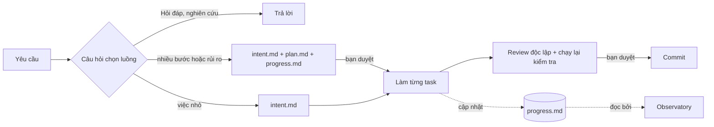

# Athena Starter

### Cho Claude Code một bộ nhớ sống lâu hơn cuộc chat, và một quy trình nó không thể bỏ qua.

Đóng phiên, bị nén context, tuần sau mở lại: agent vẫn biết **đang làm mục tiêu nào của dự án, đang chạy plan nào, task tiếp theo là gì**. Và mọi yêu cầu đều đi cùng một đường có kỷ luật: điều hướng → phạm vi → plan → test đỏ → review độc lập → commit.

[English](README.md) · Tiếng Việt

```
/plugin install athena-starter --marketplace zzgiabaozzbui/athena-starter
```


*Không phải mockup: đây là plan 14 task thật đã dựng nên bộ kit này, hiển thị trong Agent Observatory. Mỗi thẻ là một task với trạng thái, agent và token đã dùng; cạnh nối là phụ thuộc.*

## Vì sao

Agent code rất giỏi trong hai mươi phút đầu rồi quên sạch. Plan nằm trong chat, chat bị nén, và agent "bắt đầu lại" một việc đã xong 60%. Trong lúc đó nó đã sửa mười hai file khi chưa ai chốt phạm vi, "sửa" bug mà không chứng minh, và tự review việc của chính mình.

Athena Starter xử lý cả hai nửa:

| | **🧠 Bộ nhớ dài hạn** | **⚙️ Quy trình giữ vững** |
|---|---|---|
| **Là gì** | Trạng thái dự án, plan và task ghi vào Markdown và JSON trong repo | 30 luồng, 18 skill, 6 agent và các hook an toàn |
| **Sống sót qua** | Nén context, phiên mới, máy khác, đồng đội khác | Prompt vội, "sửa nhanh cái này thôi", sự lạc quan của chính agent |
| **Bạn được** | "Đến đâu rồi? Còn gì? Gì chờ tôi?" trả lời từ file, không đoán | Chốt phạm vi trước khi sửa, test đỏ trước khi fix, reviewer mắt mới trước khi "xong" |
| **Bạn thấy** | Agent Observatory: đồ thị, Kanban, timeline, lộ trình | Mỗi yêu cầu một câu hỏi chọn luồng, phương án khuyên dùng đứng đầu |

## 🧠 Bộ nhớ: agent luôn biết mình đang ở đâu

Không database, không embedding, không cloud. Bộ nhớ là file bạn đọc được, diff được, commit được, chia ba cấp:

| Hỏi bằng lời thường | Cấp | Nhớ ở |
|---|---|---|
| "Dự án làm đến đâu rồi? Còn thiếu gì?" | **Dự án** | `docs/du-an/lo-trinh.json`: mục tiêu, rồi các hạng mục của từng mục tiêu, mỗi mục có trạng thái, người phụ trách, hạn và tiêu chí nghiệm thu |
| "Đang ở bước nào trong plan?" | **Plan** | `docs/artifact/<ngày-tên>/plan.md`: các task và phụ thuộc giữa chúng |
| "Còn việc gì? Việc gì bị chặn? Việc gì chờ tôi?" | **Task** | `progress.md`: mỗi task một dòng, `TODO` · `DOING` · `CHỜ-USER` · `BLOCKED` · `DONE` · `SKIP` |
| "Bước tiếp theo là gì?" | **Task** | Các task sẵn sàng, xếp theo số task đang chờ phía sau |

- **Làm tiếp đúng chỗ đã dừng.** Sau khi nén context, hook phiên nhắc agent làm tiếp plan đang chạy từ `intent.md` và `progress.md` thay vì làm lại từ đầu. Phiên mới đọc cùng các file đó.
- **Ghi ra trước khi bắt đầu.** Việc nhiều bước có `plan.md` và `progress.md`, được bạn duyệt trước task 1; bảng cập nhật sau mỗi task.
- **Phạm vi cũng là bộ nhớ.** `intent.md` liệt kê các file agent được sửa. Ngoài danh sách phải được bạn đồng ý đích danh, kể cả ba phiên sau.

## ⚙️ Quy trình: mỗi yêu cầu đi đúng đường

Trước khi đọc hay sửa gì, agent nhắc lại yêu cầu và xếp nó vào một trong **30 luồng**. Hiểu sai chỉ tốn một cú click, không phải mười file đã sửa.

```
Bạn:    Người dùng xem được hồ sơ của phòng ban khác trên màn hình báo cáo.
Agent:  Bạn muốn người dùng chỉ thấy hồ sơ phòng mình. Chọn luồng nào?
          > Phân quyền · #12 (Khuyên dùng): CRITICAL, bạn duyệt đề xuất trước khi sửa, test thật bằng tài khoản thường
            Sửa bug · #6: viết test đỏ trước
            Sửa giao diện · #15: chỉ frontend
```

Mỗi luồng có mức rủi ro riêng: sửa một dòng phân quyền vẫn đi đủ quy trình, sửa một lỗi chính tả thì không.



1. **Điều hướng.** Nhắc lại yêu cầu, đề xuất một luồng, liệt kê phương án gần nhất.
2. **Phạm vi.** Ghi `intent.md` với các file được sửa.
3. **Plan.** Việc nhiều bước hoặc rủi ro có `plan.md` + `progress.md` để bạn duyệt.
4. **Làm.** Task giao cho đúng agent (`developer`, `quick-fix`...). Fix bắt đầu bằng test đỏ đúng lý do.
5. **Review và kiểm chứng.** Reviewer với context mới kiểm tra diff; agent chính tự chạy lại kiểm tra thay vì tin báo cáo.
6. **Commit.** Chỉ file được nêu tên, quét dữ liệu nhạy cảm trước, không push khi chưa có bạn đồng ý.

| Nhóm | Luồng |
|---|---|
| **Từ ý tưởng đến bàn giao** | Yêu cầu mơ hồ (làm rõ phạm vi trước) · Tính năng lớn một phía · Tính năng cả backend + frontend · Review code · Commit / push / release |
| **Việc rủi ro cao** | Sự cố production · Sửa bug · Module CRUD mới · Schema / migration · Ghi dữ liệu database · Phân quyền · Endpoint công khai · Config dùng chung |
| **Việc nhỏ, không cần plan** | Lỗi chính tả / format / đổi tên · Code backend thường · Viết test · Sửa giao diện |
| **Độc lập** | Hỏi đáp · Nghiên cứu nhiều file · Mockup / prototype · Tài liệu · Giải conflict · Nâng cấp lớn · Tiến độ plan · Thuật ngữ và ADR · Kiến trúc (C4) · Kiểm thử bảo mật · Lộ trình dự án |

Đã biết luồng? Gõ `Flow: #6` hoặc gọi tên skill, agent bỏ qua câu hỏi.

### Hàng rào an toàn

| Không có | Có Athena Starter |
|---|---|
| Agent sửa code khi chưa ai chốt phạm vi. | Mỗi yêu cầu mới có câu hỏi chọn luồng; phạm vi ghi vào `intent.md` trước khi sửa file. |
| Bug được "sửa" mà không có bằng chứng. | Bug fix và thay đổi hành vi bắt đầu bằng test đỏ. |
| Agent tự review rồi tự báo xong. | Thay đổi rủi ro qua reviewer riêng; "xong" phải có kết quả kiểm tra của chính lượt đó. |
| Plan và ghi chú rải rác khắp các cuộc chat. | Mỗi task một thư mục `docs/artifact/<ngày>-<tên>/`, dashboard đọc được. |
| `git commit --no-verify` lặng lẽ bỏ qua hook. | Hook chặn bỏ qua hook và các sửa đổi nới lỏng config lint. |

## 👀 Theo dõi trực tiếp: Agent Observatory

Các file bộ nhớ hiển thị trên dashboard chạy local: tổng quan, Kanban, danh sách mission, đồ thị plan, timeline, lộ trình, thống kê agent và skill.

- **Bộ đếm "Cần bạn"** trên tiêu đề tab cho task đang chờ bạn hoặc bị chặn, có thể bật thông báo trình duyệt.
- **Token và chi phí theo task**, cảnh báo khi token tăng vọt, vượt ngân sách hoặc agent đứng im.
- **Cảnh báo quy trình**: task báo xong mà không chạy kiểm tra sau lần sửa cuối, một file bị sửa đi sửa lại, lệnh lỗi chạy lại mà không đổi gì.
- **Export Summary** ghi báo cáo mission vào thư mục của nó.

**[Tải bản cài Windows mới nhất](https://github.com/zzgiabaozzbui/athena-starter/releases/latest)** (`Agent-Observatory-Setup-*.exe`), hoặc dùng ngay trong Claude Code:

```
/plugin install athena-observatory@athena
```

Chỉ đọc, chạy local trên 127.0.0.1, không gửi gì ra ngoài. Hiện chỉ có bản Windows.

## Bắt đầu nhanh

```
/plugin install athena-starter --marketplace zzgiabaozzbui/athena-starter
```

Mở phiên mới và yêu cầu bất cứ việc gì. Agent trả lời bằng câu hỏi chọn luồng, rồi làm theo skill tương ứng. Hook cần Node 18 trở lên trong PATH.

Chi tiết về 18 skill, 6 agent, 3 hook, cài đặt cho Claude Code cũ / APM và cách tùy biến: xem [README tiếng Anh](README.md).

## Ghi công và giấy phép

MIT. Một số skill được chuyển thể từ [obra/superpowers](https://github.com/obra/superpowers), [mattpocock/skills](https://github.com/mattpocock/skills) và các nguồn khác; tất cả được ghi trong [`NOTICE`](NOTICE).
